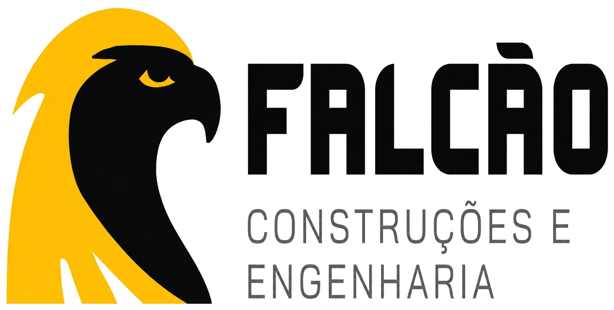
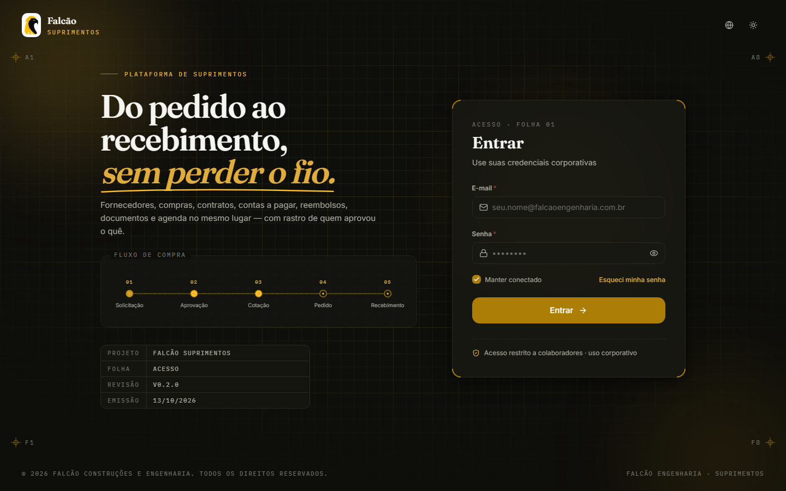
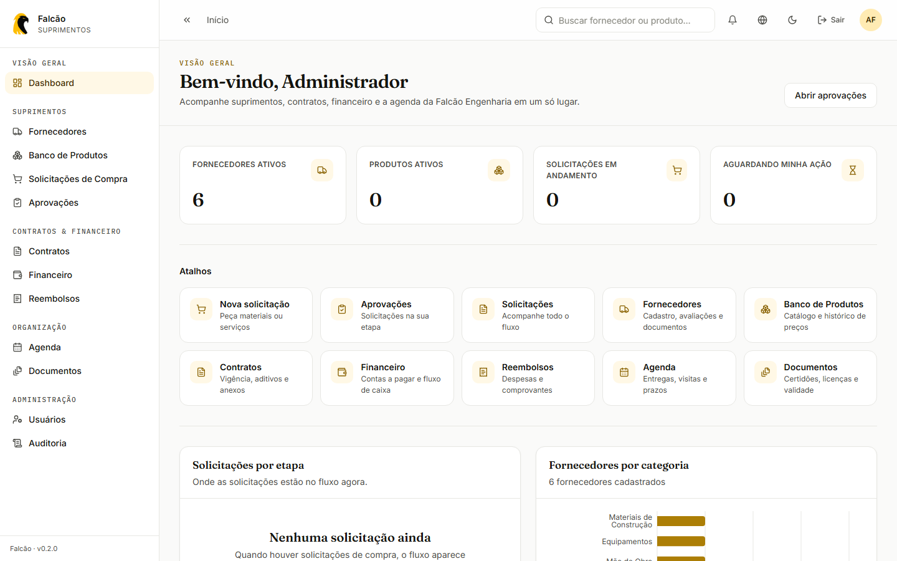
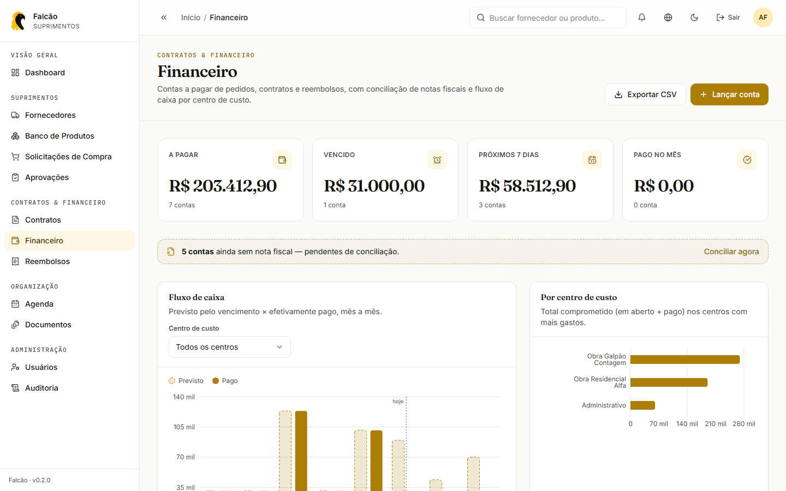
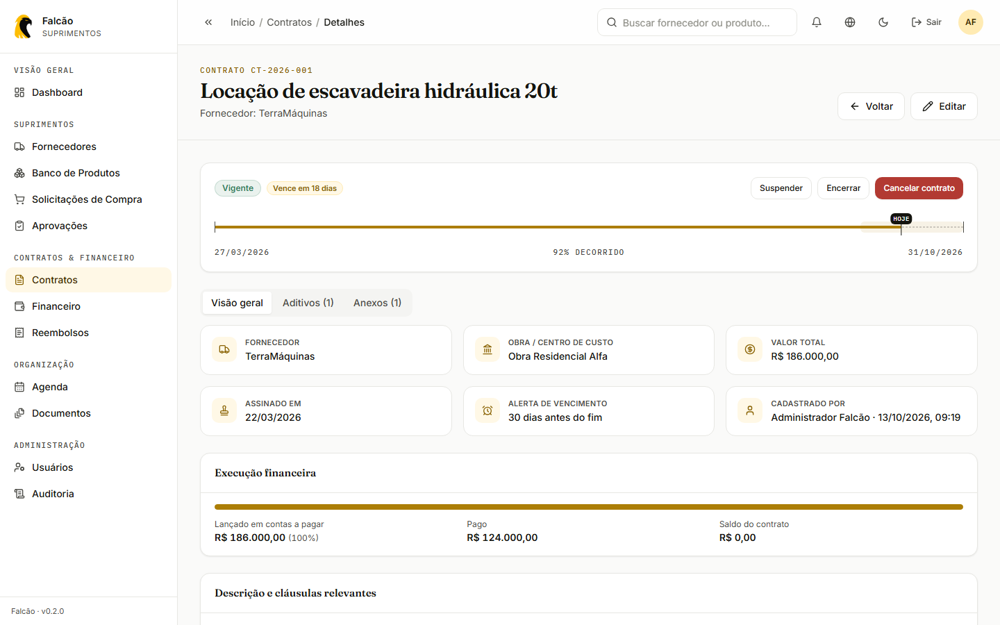
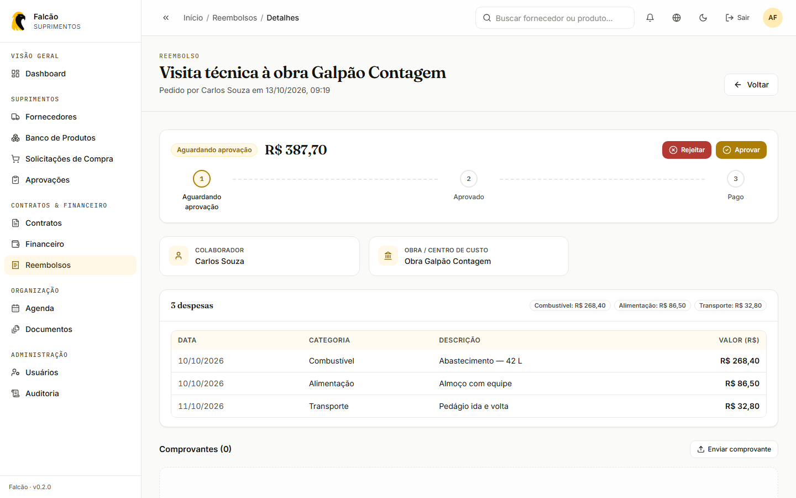
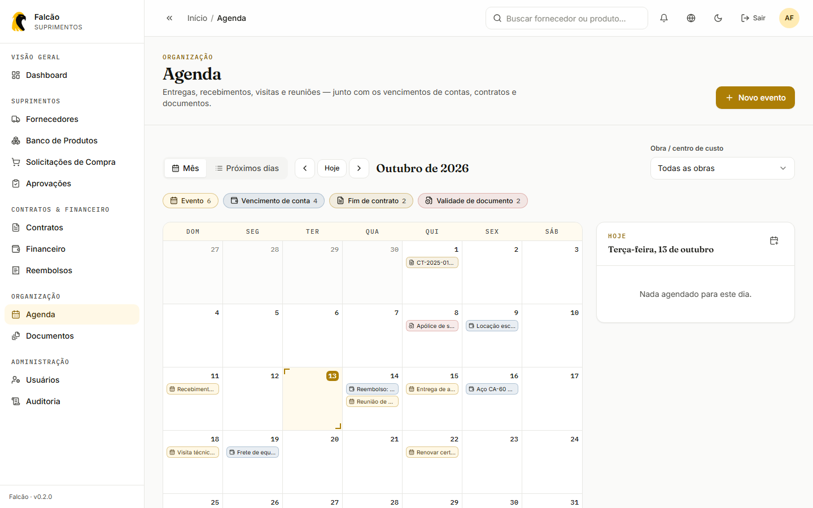
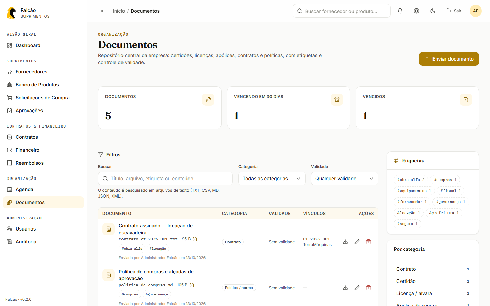
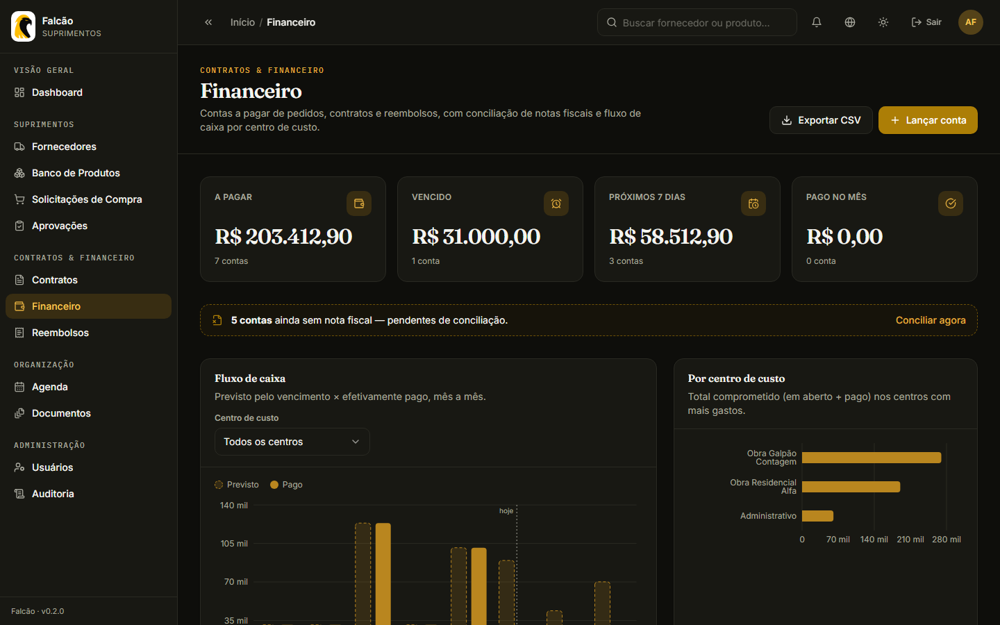

<p align="center">
  
</p>

<h1 align="center">🦅 Falcão · Suprimentos</h1>

<p align="center">
  <em>Do pedido ao recebimento, sem perder o fio.</em>
</p>

> ERP de suprimentos da Falcão Construções e Engenharia: fornecedores, banco de produtos, solicitações de compra com aprovação, contratos com aditivos, contas a pagar com fluxo de caixa, reembolsos, repositório de documentos e agenda unificada — em pt-BR, en-US e zh-CN.

<p align="center">
  <a href="https://github.com/mdevsec-code/falcao-ERP-suprimentos-master/actions/workflows/ci.yml"></a>
  <a href=".nvmrc"></a>
  
  
  
</p>

<p align="center">
  
  
  
  
  
  
  <br>
  
  
  
  
  
  
</p>

---

## 📑 Sumário

- [📸 Telas](#-telas)
- [✨ Recursos](#-recursos)
- [🛠️ Stack](#️-stack)
- [🏗️ Arquitetura](#️-arquitetura)
- [🚀 Começando](#-começando)
- [🔐 Perfis e permissões](#-perfis-e-permissões)
- [🔌 API](#-api)
- [🛡️ Segurança](#️-segurança)
- [🎨 Padrão visual e de código](#-padrão-visual-e-de-código)
- [📜 Histórico de construção](#-histórico-de-construção)
- [📍 Estado atual e próximos passos](#-estado-atual-e-próximos-passos)

---

## 📸 Telas

<p align="center">
  
</p>

| Dashboard | Financeiro |
| :---: | :---: |
|  |  |
| **Contrato** | **Reembolso** |
|  |  |
| **Agenda** | **Documentos** |
|  |  |

<details>
<summary>Tema escuro</summary>
<br>

</details>

---

## ✨ Recursos

**Suprimentos**
- **Fornecedores** — cadastro completo (razão social, CNPJ, categoria, localização), contatos, avaliações de desempenho e upload de documentos.
- **Banco de produtos** — catálogo por empresa, fornecedor primário e alternativos, histórico de preços por fornecedor e unidade de medida.
- **Solicitações de compra** — fluxo `aguardando aprovação → em compras → em cotação → pedido realizado → aguardando recebimento → finalizado` (ou rejeição), com itens, comentários, anexos, trilha de aprovações e fila "Aprovações" por papel.

**Contratos & Financeiro**
- **Contratos** — vigência com janela de alerta e régua visual do prazo, aditivos que alteram valor e/ou término, status (vigente, suspenso, encerrado, cancelado), anexos e execução financeira (lançado × pago × saldo).
- **Financeiro** — contas a pagar vinculadas a contrato, pedido ou reembolso (herdando fornecedor e centro de custo), baixa com forma de pagamento, conciliação de nota fiscal, fluxo de caixa previsto × pago, ranking por centro de custo e exportação CSV.
- **Reembolsos** — despesas com comprovantes; o gestor aprova (gerando a conta a pagar) ou rejeita com motivo; quando o financeiro paga, o reembolso vira "pago".

**Organização**
- **Documentos** — repositório central com categorias, etiquetas, controle de validade, vínculo com fornecedor/contrato e busca por conteúdo em arquivos de texto.
- **Agenda** — calendário mensal e lista dos próximos dias com entregas, recebimentos, visitas, reuniões e lembretes, mais os prazos dos outros módulos (contas, contratos, documentos), com visão por obra.

**Plataforma**
- **Dashboard** — KPIs de suprimentos, atalhos, pendências (contratos vencendo, contas vencidas, reembolsos a decidir) e os próximos 7 dias da agenda — tudo filtrado pelo papel de quem vê.
- **Autenticação e multi-tenancy** — JWT (access + refresh), dados isolados por empresa (`Company`), RBAC por papel no back e por permissão no front.
- **Usuários, perfil e auditoria** — administração de usuários, "Meu perfil" e trilha de auditoria com filtros.
- **Internacionalização** — pt-BR, en-US e zh-CN, com teste que garante a paridade das traduções.

---

## 🛠️ Stack

| Camada | Ferramentas |
| --- | --- |
| **Web** (`apps/web`) | React 18 · Vite 5 · TypeScript strict (`noUncheckedIndexedAccess`) · React Router 6 |
| Estilo e UI | Tailwind CSS 3 sobre tokens em CSS · Radix UI · Lucide · Framer Motion · Recharts |
| Estado e dados | TanStack Query 5 · Zustand 4 (sessão e preferências) · Axios com refresh token |
| Formulários | React Hook Form 7 + Zod |
| i18n | i18next + react-i18next (pt-BR, en-US, zh-CN) |
| **API** (`apps/api`) | NestJS 10 · Passport JWT · class-validator · helmet · throttler |
| Banco | PostgreSQL · Prisma 5 |
| **Compartilhado** | `packages/shared-types` — DTOs, enums e regras de datas usados por API e Web |
| Qualidade | Vitest + Testing Library · ESLint (`jsx-a11y`) · Prettier · GitHub Actions |
| Infra local | npm workspaces · Docker Compose (PostgreSQL) |

---

## 🏗️ Arquitetura

Monorepo com npm workspaces. No Web, cada módulo em `features/` segue o mesmo padrão interno: `types.ts` (schemas Zod + conversões formulário ⇄ API), `services/*.api.ts`, `hooks/` (TanStack Query), `components/` e `pages/`. Na API, cada módulo tem controller, service, repository e DTOs.

```
falcao-ERP-suprimentos-master/
├── apps/
│   ├── api/                       # API NestJS
│   │   ├── prisma/                # schema, migrations e seed
│   │   └── src/
│   │       ├── common/            # decorators, guards, filters, interceptors, papéis por módulo
│   │       └── modules/           # auth, users, companies, suppliers, products, purchase-requests,
│   │                              # contracts, finance, reimbursements, documents, agenda,
│   │                              # audit, health, storage
│   └── web/                       # SPA React
│       └── src/
│           ├── app/               # Providers, Router (lazy + guardas de permissão), error boundaries
│           ├── components/        # ui/ (design system), layout/, brand/, charts/, common/, feedback/…
│           ├── features/          # auth, dashboard, suppliers, products, purchase-requests, contracts,
│           │                      # finance, reimbursements, documents, agenda, users, audit, profile
│           ├── constants/         # rotas, papéis, permissões (RBAC), enums traduzidos, i18n
│           ├── i18n/              # i18next + locales/{pt-BR,en-US,zh-CN}/*.json
│           ├── services/ store/ styles/ hooks/ utils/ validators/ config/
├── packages/
│   └── shared-types/              # tipos compartilhados entre API e Web
├── docs/screenshots/              # imagens deste README
├── docker-compose.yml             # PostgreSQL para desenvolvimento
└── package.json                   # workspaces, scripts e overrides de segurança
```

**Modelo de dados** (`apps/api/prisma/schema.prisma`): `Company` (tenant) · `User` · `Supplier` · `Product` · `PurchaseRequest` · `Contract`/`ContractAmendment` · `Payable` · `Reimbursement` · `Document` · `AgendaEvent` · `AuditLog`.

---

## 🚀 Começando

### Pré-requisitos

- **Node.js 22.12+** (veja [`.nvmrc`](.nvmrc)) e npm 10+
- **Docker** (para o PostgreSQL local) ou uma instância PostgreSQL própria

### Instalação

```bash
# 1. Clone e instale
git clone https://github.com/mdevsec-code/falcao-ERP-suprimentos-master.git
cd falcao-ERP-suprimentos-master
npm install

# 2. Variáveis de ambiente
cp .env.example .env

# 3. Banco de dados (PostgreSQL via Docker)
npm run db:up

# 4. Migrations e dados de demonstração
npm run db:migrate
npm run db:seed

# 5. API + Web em modo desenvolvimento
npm run dev
```

- Web: `http://localhost:5173`
- API: `http://localhost:3333/api/v1` (saúde em `/api/v1/health`)

### Acesso local (dados do seed)

Todos com a senha **`Falcao@123`**:

| E-mail | Perfil | Bom para testar |
| --- | --- | --- |
| `admin@falcaoengenharia.com.br` | Administrador | tudo |
| `gestor@falcaoengenharia.com.br` | Gestor | aprovar reembolsos, contratos, consulta ao financeiro |
| `carlos@falcaoengenharia.com.br` | Solicitante | pedir reembolso; agenda e documentos sem contratos/financeiro |

O seed cria fornecedores, contratos (um vencendo, um vencido), contas pagas e em aberto dos últimos meses, reembolsos, documentos e eventos de agenda com datas relativas a hoje.

> Credenciais válidas **apenas no ambiente local** de desenvolvimento.

### Variáveis de ambiente

| Variável | Descrição |
| --- | --- |
| `DATABASE_URL` | String de conexão do PostgreSQL |
| `PORT` | Porta da API (padrão `3333`) |
| `JWT_SECRET` / `JWT_ACCESS_EXPIRES_IN` | Segredo e expiração do access token |
| `JWT_REFRESH_SECRET` / `JWT_REFRESH_EXPIRES_IN` | Segredo e expiração do refresh token |
| `UPLOADS_DIR` | Diretório dos arquivos enviados |
| `CORS_ORIGIN` | Origem permitida no CORS (URL do Web) |
| `VITE_API_URL` | URL base da API consumida pelo Web |

> Nunca versione o `.env`. Gere segredos fortes para `JWT_SECRET` e `JWT_REFRESH_SECRET` antes de qualquer deploy.

### Scripts

```bash
npm run dev            # API + Web em modo watch
npm run dev:api        # só a API
npm run dev:web        # só o Web
npm run build          # build de shared-types, API e Web
npm run lint           # ESLint da API e do Web
npm run typecheck      # tipos de shared-types, API e Web
npm run test           # testes do Web (Vitest)
npm run format         # Prettier --write  (format:check para verificar)
npm run validate       # typecheck + lint + format:check + test + build (o mesmo do CI)

npm run db:up          # sobe o PostgreSQL (Docker Compose)  ·  db:down derruba
npm run db:migrate     # aplica as migrations do Prisma
npm run db:seed        # popula o banco com dados de demonstração
npm run db:studio      # abre o Prisma Studio
```

---

## 🔐 Perfis e permissões

Papéis: `ADMIN`, `MANAGER`, `BUYER`, `FINANCE`, `WAREHOUSE`, `REQUESTER`, `AUDITOR`. A API é a autoridade (`@Roles`, com os papéis por módulo em `apps/api/src/common/constants/module-roles.ts`); o Web espelha em `constants/permissions.ts` para esconder o que voltaria 403 e bloquear a rota.

| Módulo | Consulta | Altera |
| --- | --- | --- |
| Contratos | ADMIN, MANAGER, BUYER, FINANCE, AUDITOR | ADMIN, MANAGER, BUYER |
| Financeiro | ADMIN, MANAGER, FINANCE, AUDITOR | ADMIN, FINANCE |
| Reembolsos | todos (solicitantes veem só os próprios) | pedem: todos menos AUDITOR · decidem: ADMIN, MANAGER (nunca o próprio) |
| Documentos | todos | ADMIN, MANAGER, BUYER, FINANCE, WAREHOUSE |
| Agenda | todos (prazos só dos módulos que o papel consulta) | todos menos AUDITOR |
| Usuários | ADMIN | ADMIN |
| Auditoria | ADMIN, AUDITOR | — |

---

## 🔌 API

Prefixo `/api/v1` · autenticação `Authorization: Bearer <accessToken>` (de `POST /auth/login`, renovado em `POST /auth/refresh`). O token é conferido contra o banco a cada requisição: usuário desativado perde o acesso na hora.

| Recurso | Endpoints |
| --- | --- |
| Usuários | `GET/POST /users`, `GET /users/stats`, `PATCH /users/:id`, `PATCH /users/:id/password`, `GET/PATCH /users/me`, `PATCH /users/me/password` |
| Contratos | `GET/POST /contracts`, `GET /contracts/stats`, `GET/PATCH /contracts/:id`, `PATCH /contracts/:id/status`, `POST /contracts/:id/amendments` |
| Financeiro | `GET/POST /payables`, `GET /payables/stats`, `GET /payables/cash-flow`, `GET /payables/by-cost-center`, `GET /payables/cost-centers`, `GET/PATCH /payables/:id`, `PATCH /payables/:id/pay`, `PATCH /payables/:id/invoice`, `PATCH /payables/:id/cancel` |
| Reembolsos | `GET/POST /reimbursements`, `GET /reimbursements/stats`, `GET/DELETE /reimbursements/:id`, `PATCH /reimbursements/:id/decision`, `POST /reimbursements/:id/attachments`, `DELETE /reimbursements/:id/attachments/:attachmentId` |
| Documentos | `GET/POST /documents` (multipart), `GET /documents/stats`, `GET /documents/tags`, `GET/PATCH/DELETE /documents/:id` |
| Agenda | `GET /agenda?from&to&obra`, `GET /agenda/obras`, `POST /agenda/events`, `PATCH/DELETE /agenda/events/:id` |
| Auditoria | `GET /audit-logs`, `GET /audit-logs/stats` |
| Saúde | `GET /health` (público — status da API e do banco) |

Fornecedores, produtos e solicitações de compra seguem o mesmo padrão em `/suppliers`, `/products` e `/purchase-requests`.

---

## 🛡️ Segurança

- **Isolamento por empresa** na camada de consulta (`PrismaService.forCompany`); SQL bruto sempre parametrizado e com `company_id`.
- **Uploads** — o storage recusa caminhos fora de `UPLOADS_DIR` e aceita só uma lista de extensões (PDF, imagens, Office, texto, CAD, ZIP); HTML, SVG e JS são bloqueados. `/uploads` responde com `nosniff`, e o que não é PDF/imagem/texto vai como download com `Content-Security-Policy: sandbox`.
- **Cabeçalhos** via `helmet`; CORS restrito a `CORS_ORIGIN`.
- **Força bruta** — login e refresh limitados a 10 tentativas/minuto por IP; o login leva o mesmo tempo para e-mail inexistente e senha errada.
- **Concorrência** — baixa de conta, cancelamento e decisão de reembolso são atualizações condicionais: dois cliques não pagam duas vezes nem geram duas contas.
- **Validação** — `whitelist` + `forbidNonWhitelisted` (campos como `companyId` no corpo são rejeitados); erros conhecidos do Prisma viram 409/404/400.
- **CSV** — a exportação neutraliza células que o Excel executaria como fórmula.
- **Dependências** — `overrides` fixam versões corrigidas de `multer`, `body-parser`, `lodash` e `qs`.

---

## 🎨 Padrão visual e de código

Mesmo design system e convenções do [Falcão Saúde Ocupacional](https://github.com/mdevsec-code/falcao-saude-ocupacional), para que os produtos Falcão tenham uma identidade única:

- **Identidade** — dourado e grafite da logo, Fraunces (títulos), Inter (texto) e IBM Plex Mono (rótulos), tokens em `src/styles/tokens.css`, tema claro e escuro.
- **Linguagem "planta técnica"** — malha milimetrada, carimbo de prancha, cantoneiras e o fluxo de compra desenhado como diagrama vivo nas telas de entrada; régua de vigência nos contratos e calendário com marcação de hoje.
- **Componentes** — kit de UI compartilhado (`Button`, `Input`, `Select`, `Dialog`, `Tabs`, `Badge`, `Card`…), `PageHeader` com *eyebrow*, `StatTile`, estados vazio/erro/carregando, Sidebar com pílula ativa animada.
- **Animações** — transição de página, entradas escalonadas e contagem nos KPIs, respeitando `prefers-reduced-motion`.
- **Gráficos** — um único matiz da marca, validado para contraste nos dois temas.

---

## 📜 Histórico de construção

1. **Fundação** — multi-tenancy (`Company`/`User`), JWT com access + refresh e RBAC por papel.
2. **Fornecedores** — cadastro, contatos, avaliações e documentos, com storage local atrás da interface `IStorageProvider`.
3. **Banco de produtos** — catálogo, fornecedores primário/alternativos e histórico de preços.
4. **Solicitações de compra** — fluxo de aprovação, itens, comentários, anexos e auditoria (`AuditLogInterceptor`).
5. **Publicação** — versionamento no GitHub.
6. **Padronização com o Saúde Ocupacional** — frontend refeito sobre o design system e as convenções da plataforma irmã: UI, layout, animações, i18n, sessão em Zustand, RBAC por permissões, KPIs, Vitest, Prettier e CI.
7. **Administração** — usuários, auditoria, "Meu perfil", `/health` e redesenho das telas de entrada na linguagem "planta técnica".
8. **Contratos, Financeiro, Reembolsos, Documentos e Agenda** — os módulos que faltavam, integrados entre si: aditivo altera o contrato, aprovação de reembolso gera conta a pagar, pagamento fecha o reembolso e os prazos aparecem na agenda.
9. **Revisão geral e de segurança** — correção de *path traversal* no upload de anexos, bloqueio de uploads executáveis, `helmet`, limite de tentativas no login, condições de corrida em pagamentos/aprovações, injeção de fórmula no CSV e atualização de dependências vulneráveis.
10. **Dashboard operacional** — pendências e agenda dos próximos dias no lugar do antigo card "próximos módulos"; remoção das telas "em breve"; CI em Node 22 LTS.

---

## 📍 Estado atual e próximos passos

Funcional para desenvolvimento local; ainda **não pronto para produção**.

**Infraestrutura**
- Sem Dockerfile de produção para API/Web — o `docker-compose.yml` sobe apenas o PostgreSQL de desenvolvimento.
- Sem CD nem ambiente de deploy (hospedagem, variáveis de produção, HTTPS).
- Armazenamento de arquivos apenas em disco local; a interface `IStorageProvider` permite plugar S3/Azure Blob.

**Qualidade**
- Testes unitários no Web (formatação, KPIs, CSV, calendário, paridade de traduções); a API ainda não tem `*.spec.ts` versionados.
- Falta um job de CI com PostgreSQL para testes de integração.
- `npm audit` ainda aponta itens que exigem troca de versão maior: NestJS 10 → 11 e React Router 6 → 7.

**Segurança**
- Arquivos em `/uploads` são acessíveis por quem tiver a URL — para dados sensíveis, servir por rota autenticada ou URL assinada.
- Tokens no `localStorage`; cookies `httpOnly` reduziriam o impacto de um eventual XSS.
- Exigir segredos JWT de 32+ caracteres na validação de ambiente de produção.

**Produto**
- Tela de dados da empresa (`companies` ainda é só serviço interno).
- Recuperação de senha por e-mail.
- Busca por conteúdo em PDFs e documentos Office.
- Integração com os demais sistemas Falcão num hub com login único.

---

<p align="center">
  <sub>Feito para a <strong>Falcão Construções e Engenharia</strong> · parte da família de sistemas Falcão, ao lado do <a href="https://github.com/mdevsec-code/falcao-saude-ocupacional">Saúde Ocupacional</a></sub>
</p>
